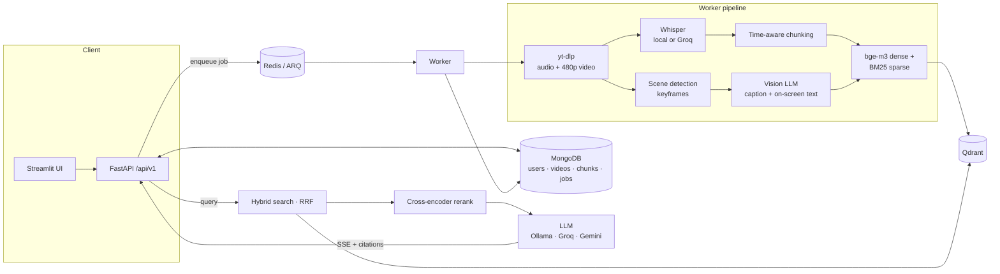

# Multimodal Video RAG

[](https://github.com/nourel25/Multimodal-AI-Video-RAG-System/actions/workflows/ci.yml)


Ask questions about YouTube videos and get answers that **cite the exact moment** in the video.
The system indexes both what is **said** (Whisper transcripts) and what is **shown** (scene
keyframes captioned by a vision LLM, including on-screen text), retrieves with **hybrid
dense + BM25 search and cross-encoder reranking**, and streams grounded answers with
clickable `[n]` citations that jump to the timestamp. Works in **English and Arabic**.

Every model is swappable through configuration: run fully local (faster-whisper, Ollama,
bge-m3) or use hosted APIs (Groq Whisper and Llama, Gemini vision) with automatic retry and
fallback.

<!-- Record a short demo (UI: add a video -> ask a question -> click a citation) and save it as docs/demo.gif -->

## Features

- **Multimodal indexing** — transcript chunks *and* visual chunks (scene detection →
  keyframes → vision-LLM caption + OCR of slides/code) in one index, tagged by modality.
- **Timestamped citations** — every chunk keeps the start/end time of its Whisper segments;
  answers link to `youtube.com/watch?v=…&t=…s`.
- **Hybrid retrieval** — multilingual dense vectors (bge-m3) + BM25-style sparse vectors with
  Arabic normalisation, fused with Reciprocal Rank Fusion inside Qdrant, then reranked by
  `bge-reranker-v2-m3`.
- **Provider-agnostic** — `LLMInterface` with Ollama / Groq / Gemini implementations,
  transcription via local faster-whisper or Groq Whisper, chosen in `.env`.
- **Free-tier friendly** — client-side rate limiting per provider, retries that honor the
  provider's `Retry-After`, a fallback provider for answers and (optionally) transcription,
  and a circuit breaker that stops frame captioning when the quota runs out instead of
  burning more calls; the transcript is still indexed.
- **Async background processing** — `POST /process` returns `202` with a job id; an ARQ worker
  (or in-process queue for local dev) runs the pipeline and reports per-stage progress.
- **Streaming answers** over Server-Sent Events, with conversation history.
- **Measured** — an evaluation harness reports Hit@k / MRR for each retrieval strategy.
- **Production basics** — typed request/response models, consistent error signals, optional
  API-key auth, health checks, structured logging, 60+ tests, CI, one-command Docker stack.

## Architecture



**Ingestion** (`controllers/ProcessController.py`): download low-bitrate audio → transcribe
(language auto-detected) → group Whisper segments into chunks without splitting a segment, so
each chunk has exact timestamps → optionally download a 480p video stream, detect scene cuts,
keep one deduplicated keyframe per scene and caption it → embed and upsert. Failures are
recorded per video; a failed re-run never wipes a previously indexed video.

**Retrieval** (`controllers/NLPController.py`): the query is embedded once for dense search and
tokenised for sparse search; both run as Qdrant prefetches fused with RRF, optionally filtered
to selected videos; the top candidates are reranked by a cross-encoder.

**Generation**: numbered sources (with modality, video title and timestamp) go into a
language-specific prompt (English/Arabic, detected from the question) that requires `[n]`
citations; the answer streams token by token.

## Evaluation

`eval/` contains a labelled question set over English and Arabic videos. Each question is
labelled with a **time window** in a video rather than a chunk id, so labels stay valid when
chunking or the transcript changes. A retrieved chunk counts as a hit if it overlaps the window.

**80 questions** (42 English, 38 Arabic incl. Egyptian dialect) over **9 videos** (~32 min),
135 chunks of ≤ 300 characters, `bge-m3` embeddings, `bge-reranker-v2-m3` reranker, RTX 3060 (fp16):

| Retrieval | Hit@1 | Hit@3 | Hit@5 | MRR@10 | Arabic Hit@5 | Latency / query |
|---|---|---|---|---|---|---|
| Sparse (BM25) | 0.56 | 0.76 | 0.79 | 0.67 | 0.66 | 1 ms |
| Dense (bge-m3) | 0.76 | 0.90 | 0.93 | 0.83 | 0.89 | 20 ms |
| Hybrid (RRF) | 0.71 | 0.90 | 0.96 | 0.81 | 0.95 | 17 ms |
| **Hybrid + rerank** | **0.86** | **0.97** | **1.00** | **0.92** | **1.00** | 97 ms |

What the numbers say:

- **Hybrid search fixes recall, reranking fixes ranking.** Adding BM25 lifts Hit@5 from 0.93 to
  0.96 (Arabic 0.89 → 0.95) but slightly lowers Hit@1; the cross-encoder then lifts Hit@1 from
  0.71 to 0.86 and MRR from 0.81 to 0.92 — every question gets a correct source in the top 5.
- **Cross-lingual questions** (Arabic questions about a video whose transcript came out in
  English) are where BM25 has nothing to match: sparse Hit@1 is 0, and fusing it in drops Hit@1
  from 0.75 to 0.25. The reranker restores it to 1.00, which is why it is on by default.
- **GPU matters for reranking:** on CPU the reranker took 3.8 s per query (fp32); on the GPU in
  fp16 it takes 97 ms with identical scores.
- With the default 800-character chunks (43 chunks) the task is easier — Hybrid + rerank reaches
  Hit@1 0.93 / MRR 0.96 — but each citation covers a longer stretch of video.

Full per-language breakdowns: [`eval/results/`](eval/results/). The set is small and the
questions were written for this project from the transcripts, so treat it as a regression benchmark
for comparing configurations, not a general-purpose leaderboard score.

Reproduce:

```bash
python eval/build_corpus.py          # download + transcribe eval videos into eval/corpus/
python eval/run_retrieval_eval.py --chunk-chars 300 --tag gpu_c300   # writes eval/results/
```

## Quickstart

### Docker (full stack)

```bash
cp src/.env.example src/.env          # pick backends, add GROQ_API_KEY / GEMINI_API_KEY if used
cp docker/.env.example docker/.env    # set a MongoDB password
cd docker
docker compose up -d --build
```

- API + Swagger docs: http://localhost:8800/docs
- UI: http://localhost:8850

The compose project is named `multimodal-rag`: containers, volumes and networks are all
prefixed with it, no `container_name` is used and every port binds to `127.0.0.1` on a
non-default number, so it runs alongside other Docker projects without touching them.
Ollama runs on the host by default; `docker compose --profile local-llm up -d` runs it in a
container instead (set `OLLAMA_HOST=http://ollama:11434`). With an NVIDIA GPU, add
`-f docker-compose.gpu.yml` to run the embedding model and reranker on it.

**Resource note.** Only the embedding model (bge-m3) and the reranker run locally: about
2.2 GB of VRAM in fp16 on a GPU (`EMBEDDING_DEVICE=auto`), or ~4.5 GB of RAM on CPU. Each
process loads them once and jobs run one at a time. With the ARQ worker the API and the worker
each hold a copy, so on a laptop the default single-process `inline` queue is the lighter choice.

### Local development

```bash
python -m venv .venv && source .venv/bin/activate   # Windows: .venv\Scripts\activate
pip install torch --index-url https://download.pytorch.org/whl/cu130  # NVIDIA GPU (or .../whl/cpu)
pip install -r src/requirements.txt -r src/requirements/dev.txt -r ui/requirements.txt

cd docker && docker compose up -d mongodb && cd ..  # or point MONGODB_URL at any MongoDB
cp src/.env.example src/.env                        # JOB_QUEUE_BACKEND=inline needs no Redis

cd src && uvicorn main:app --reload                 # API on :8000
streamlit run ui/app.py                             # UI on :8501 (from the repo root)
pytest                                              # from the repo root
```

## Configuration

All settings live in [`src/.env.example`](src/.env.example). The important switches:

| Setting | Options | Default |
|---|---|---|
| `TRANSCRIPTION_BACKEND` | `GROQ` (whisper-large-v3-turbo), `LOCAL` (faster-whisper) | `GROQ` |
| `GENERATION_BACKEND` / `GENERATION_FALLBACK_BACKEND` | `GROQ`, `GEMINI`, `OLLAMA` | `GROQ` / `GEMINI` |
| `VISION_BACKEND` | `GEMINI`, `OLLAMA`, `GROQ`, empty (off) | `GEMINI` |
| `VISION_MAX_FRAMES` | vision API calls per video | `12` |
| `GROQ_REQUESTS_PER_MINUTE` / `GEMINI_REQUESTS_PER_MINUTE` | client-side throttle (0 = off) | `25` / `8` |
| `TRANSCRIPTION_FALLBACK_BACKEND` | e.g. `LOCAL` when Groq's audio quota runs out | none |
| `EMBEDDING_MODEL` | any sentence-transformers model | `BAAI/bge-m3` |
| `RETRIEVAL_MODE` | `dense`, `sparse`, `hybrid` | `hybrid` |
| `RERANK_ENABLED` / `RERANKER_MODEL` | cross-encoder | `true` / `BAAI/bge-reranker-v2-m3` |
| `JOB_QUEUE_BACKEND` | `inline` (in-process), `arq` (Redis worker) | `inline` |
| `QDRANT_URL` | empty = embedded on-disk Qdrant | empty |
| `API_KEY` | empty = no auth | empty |

## API

Interactive docs at `/docs`; the OpenAPI spec is exported to [`docs/openapi.json`](docs/openapi.json)
(importable into Postman).

| Method | Path | Purpose |
|---|---|---|
| `POST` | `/api/v1/users/{user_id}/videos` | Add YouTube URLs (validated, de-duplicated), optionally auto-process |
| `GET` | `/api/v1/users/{user_id}/videos` | List videos with status and chunk counts |
| `DELETE` | `/api/v1/users/{user_id}/videos/{video_id}` | Remove a video, its chunks and vectors |
| `POST` | `/api/v1/users/{user_id}/process` | Queue processing → `202` + job |
| `GET` | `/api/v1/users/{user_id}/jobs/{job_id}` | Job status, stage, progress, per-video results |
| `POST` | `/api/v1/users/{user_id}/search` | Retrieve sources (`mode`, `rerank`, `video_ids`) |
| `POST` | `/api/v1/users/{user_id}/answer` | Grounded answer + cited sources |
| `POST` | `/api/v1/users/{user_id}/answer/stream` | Same, streamed as SSE (`sources`, `token`, `done`) |
| `POST` | `/api/v1/users/{user_id}/index/rebuild` | Re-embed stored chunks after changing the model |
| `GET` | `/api/v1/health` | Dependency checks and active backends |

```bash
curl -X POST localhost:8800/api/v1/users/demo/videos -H 'Content-Type: application/json' \
  -d '{"youtube_urls": ["https://youtu.be/T-D1OfcDW1M"], "auto_process": true}'

curl -X POST localhost:8800/api/v1/users/demo/answer -H 'Content-Type: application/json' \
  -d '{"query": "Why does RAG reduce hallucinations?"}'
```

## Project structure

```
src/
  main.py                 app factory, lifespan, routers
  worker.py               ARQ worker entry point
  core/container.py       composition root: clients and models built once, lazily
  routes/                 HTTP layer: schemas, dependencies, error handlers
  controllers/            pipeline + business logic (video, audio, chunking, vision, NLP, jobs)
  models/                 MongoDB documents and data access
  stores/
    llm/                  LLMInterface, Ollama/Groq/Gemini providers, retry, fallback
    transcription/        local faster-whisper and Groq Whisper
    embedding/            dense embedder, BM25 sparse encoder, reranker
    vectordb/             Qdrant provider (hybrid search)
    jobs/                 ARQ and in-process job queues
    templates/            English/Arabic prompts
ui/                       Streamlit front end
eval/                     corpus builder, question set, retrieval evaluation
tests/                    unit + API tests (in-memory MongoDB and Qdrant, fake models)
docker/                   Dockerfiles and compose stack
```

## Design notes

- **Why keep whole Whisper segments in a chunk?** Splitting by characters loses the link to
  time. Grouping segments keeps exact `start`/`end` for every chunk, which is what makes
  deep-link citations possible.
- **Why hybrid search?** Dense vectors capture paraphrases; BM25 catches exact names, numbers
  and code identifiers that embeddings blur. RRF fuses them without score calibration.
- **Why a stateless, hashed BM25 encoder?** Qdrant applies IDF itself (`Modifier.IDF`), so the
  encoder only needs term frequencies — no vocabulary to store or keep in sync.
- **Why time-window labels in the eval set?** They survive any change to chunk size, overlap or
  transcription model, so retrieval configurations can be compared fairly.
- **Why a job queue?** Transcription takes minutes; HTTP requests should not. The in-process
  queue keeps local development dependency-free, ARQ makes it survive restarts and scale out.

